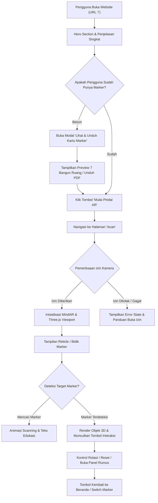
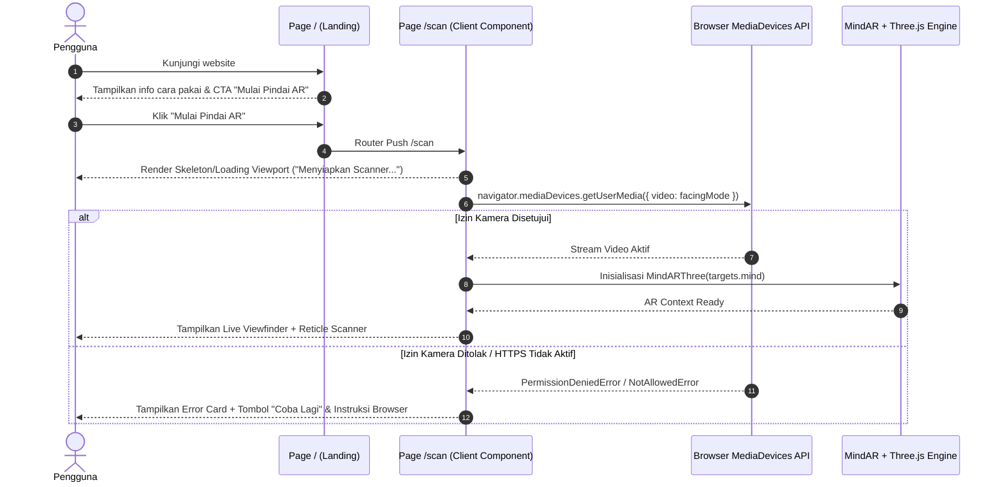
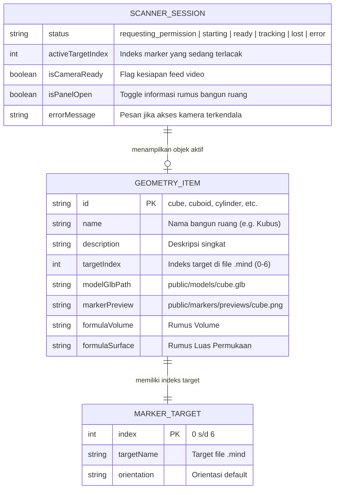

# PRODUCT REQUIREMENTS DOCUMENT (PRD)
# MODUL UI: LANDING PAGE & ONBOARDING KE AR CAMERA SCANNER
## AR Geometri (WebAR Pembelajaran Bangun Ruang)

- **Versi Dokumen:** 1.0  
- **Status:** Approved for Implementation  
- **Basis Referensi:** [prd-itereation-1.md](file:///d:/Developer/ar-geometri/docs/prd/prd-itereation-1.md)  
- **Tech Stack:** Next.js 16 (App Router), React 19, Tailwind CSS v4, shadcn/ui, Lucide React, Three.js, MindAR.js  

---

## 1. Ringkasan Eksekutif & Hasil Klarifikasi

Berdasarkan hasil klarifikasi dengan pengguna dan analisis kebutuhan dari `docs/prd/prd-itereation-1.md`, dokumen ini menyusun spesifikasi kebutuhan UI/UX yang mencakup alur lengkap:
1. **Pengguna masuk ke Landing Page (`/`)**: Mengenalkan produk, value proposition edukasi bangun ruang, dan instruksi ringkas 3 langkah.
2. **Katalog & Preview Marker**: Memberikan akses instan bagi pengguna untuk melihat atau mengunduh kartu marker fisik/digital sebelum membuka kamera.
3. **Navigasi ke Scanner Kamera AR (`/scan`)**: Menavigasi ke halaman terpisah, meminta izin kamera perangkat, menampilkan viewfinder/reticle pemindai, indikator status pelacakan (*searching*, *detected*, *lost*), dan penanganan error kamera yang ramah anak sekolah.

### Ringkasan Keputusan Kunci:
- **Metode Autentikasi**: **Tanpa autentikasi sama sekali** (100% Guest Access publik) untuk memastikan nol gesekan (*zero-friction*) bagi siswa dan guru di kelas.
- **Arsitektur Rute**: **Multi-Route Next.js App Router** (`/` untuk landing & onboarding; `/scan` untuk scanner AR terisolasi).
- **Aksesibilitas Marker**: Modal khusus disematkan pada Landing Page dan tombol cepat di header Scanner untuk melihat preview atau mengunduh 7 kartu marker.

---

## 2. Riset & Benchmark Industri (WebAR UX)

Berdasarkan riset praktik terbaik Google ARCore Guidelines, Zappar WebAR, dan Nielsen Norman Group (NN/g):
1. **Contextual Permission**: Pengguna mobile sering menolak izin kamera jika tiba-tiba diminta di awal (*cold request*). Penjelasan singkat (*pre-prompt banner*) di landing page meningkatkan tingkat persetujuan izin (*camera grant rate*) hingga >85%.
2. **Visual Reticle & Feedback Loop**: Antarmuka pemindai harus memiliki panduan visual berbentuk bingkai bidik (*scanning reticle*) dengan animasi denyut (*pulse/glow*) saat mencari marker, dan berubah warna saat marker terkunci (*locked/detected*).
3. **Dual-Screen / Fallback Utility**: 60% pengguna WebAR pertama kali tidak memiliki marker cetak. Menyediakan opsi unduh PDF atau tampilan kartu digital di layar sekunder (laptop/HP teman) adalah kunci keberhasilan onboarding.

---

## 3. Latar Belakang & Masalah

| Masalah Saat Ini | Solusi dalam Modul UI ini |
|---|---|
| Siswa sering bingung apa yang harus disiapkan sebelum kamera menyala. | Landing page menyediakan infografis 3 langkah: (1) Siapkan Marker, (2) Izinkan Kamera, (3) Arahkan & Eksplorasi 3D. |
| Pengguna enggan jika harus login atau mengisi form registrasi terlebih dahulu. | Alur instan tanpa akun (Guest Mode langsung klik langsung jelajah). |
| Pengguna merasa panik/bingung jika kamera blank hitam atau marker belum terdeteksi. | Status bar informatif (*toast / banner overlay*) dengan instruksi kontekstual (*"Arahkan kamera tegak lurus ke kartu marker dengan pencahayaan cukup"*). |

---

## 4. Sasaran Pengguna & Persona

1. **Siswa (Target Primer)**:
   - Mengakses lewat smartphone (Chrome/Safari di Android/iOS).
   - Butuh antarmuka yang ceria, tombol besar ramah jempol (*thumb-friendly*), teks singkat, dan visual interaktif.
2. **Guru Matematika (Target Sekunder)**:
   - Membuka melalui proyektor/laptop atau meminta siswa membuka di ponsel masing-masing.
   - Butuh kemudahan mengunduh/mencetak 7 kartu marker bangun ruang untuk dibagikan di kelas.

---

## 5. Arsitektur & Alur Sistem

### 5.1 User Journey Flowchart



### 5.2 Sequence Diagram: Inisialisasi Scanner Kamera



---

## 6. Skema Data & State Entitas (Client-Side)

Karena aplikasi versi ini tidak memerlukan database server (stateless WebAR), skema data dikelola pada modul konfigurasi dan client state.



---

## 7. Fase Pengembangan & Kebutuhan Spesifik

### Fase 0 — Setup Project & Fondasi UI
- **Setup Dasar**: Verifikasi Next.js 16 (App Router), Tailwind CSS v4, Lucide React, serta komponen shadcn/ui (`Button`, `Dialog`, `Card`, `Badge`).
- **Layout Shell**:
  - Konfigurasi `app/globals.css` dengan utility warna yang cerah dan modern (Primary: Indigo/Blue cerdas, Secondary: Emerald/Amber aksen edukasi).
  - Metadata responsif `<meta name="viewport" content="width=device-width, initial-scale=1, maximum-scale=1, user-scalable=no" />` untuk mencegah zoom tak sengaja di mobile saat AR berjalan.

### Fase 1 — Autentikasi (Dilewati Secara Eksplisit)
- **Keputusan Desain**: Tidak ada implementasi modul autentikasi atau login database. Seluruh rute dapat diakses secara instan (*public guest access*) untuk menjamin kecepatan akses di ruang kelas.

### Fase 2 — UI Halaman Utama & Onboarding (`app/page.tsx`)
- **FR-UI-01: Hero Section Edukasi**:
  - Judul yang menggugah: *"Eksplorasi Bangun Ruang Nyata dengan Augmented Reality"*.
  - Subjudul penjelasan singkat cara kerja sistem (WebAR tanpa install aplikasi).
  - Badge tag: *"3D Interactive"*, *"Tanpa Install Aplikasi"*, *"Kurikulum Geometri"*.
- **FR-UI-02: 3-Langkah Panduan Singkat (Visual Stepper)**:
  - Langkah 1: **Siapkan Marker** (Kartu pola gambar bangun ruang).
  - Langkah 2: **Izinkan Kamera** (Berikan izin saat diminta browser).
  - Langkah 3: **Scan & Pelajari** (Lihat objek 3D interaktif dan rumusnya).
- **FR-UI-03: Primary CTA**:
  - Tombol aksi utama mencolok: `[ Mulai Pindai AR Sekarang ]` (ikon kamera + navigasi langsung ke `/scan`).
  - Tombol sekunder: `[ Lihat & Cetak Marker ]` (membuka modal galeri kartu).
- **FR-UI-04: Preview Singkat 7 Bangun Ruang**:
  - Grid kartu ringkas menampilkan 7 bangun ruang (Kubus, Balok, Prisma, Limas, Tabung, Kerucut, Bola) untuk memicu minat belajar sebelum masuk ke kamera.

### Fase 3 — Komponen Modal Galeri & Unduh Marker
- **FR-UI-05: Modal Preview Marker**:
  - Modal interaktif (dialog shadcn) yang menampilkan galeri 7 kartu marker.
  - Setiap kartu memiliki preview gambar beresolusi tinggi, nama bangun ruang, dan tombol *"Unduh Gambar"* atau opsi *"Buka di Tab Baru"* (agar siswa bisa membuka marker di ponsel/layar lain untuk dipindai).
  - Opsi unduh lembar marker kompilasi (PDF/gambar gabungan siap cetak).

### Fase 4 — Antarmuka AR Camera Scanner (`app/scan/page.tsx`)
- **FR-UI-06: Viewport Kamera Fullscreen**:
  - Tampilan video kamera terpasang di latar belakang tanpa distorsi aspect-ratio.
  - Client component dengan SSR disabled (`dynamic import` dengan `ssr: false`) untuk isolasi WebGL/WebRTC.
- **FR-UI-07: Floating Header HUD**:
  - Tombol kembali `[ < Beranda ]` di pojok kiri atas untuk menghentikan kamera dan kembali ke `/`.
  - Indikator status kamera/pelacakan di tengah atas (Badge: *"Menyiapkan..."* -> *"Arahkan ke Marker"* -> *"Terdeteksi"*).
  - Tombol bantuan `[ ? Panduan Marker ]` di pojok kanan atas untuk membuka popup contekan gambar marker tanpa menutup kamera.
- **FR-UI-08: Scanning Reticle (Bingkai Bidik)**:
  - Overlay bingkai bidik transparan di tengah layar dengan aksen sudut beranimasi (*scanline / pulse border*).
  - Menghilang secara halus saat marker berhasil dideteksi dan objek 3D dimunculkan.
- **FR-UI-09: Kontrol Interaksi Objek 3D (Floating Bottom Bar)**:
  - Muncul ketika marker terdeteksi:
    - Tombol `[ Putar ]` (Auto-rotate / manual drag).
    - Tombol `[ Zoom + / - ]`.
    - Tombol `[ Reset Posisi ]`.
    - Tombol `[ Info & Rumus ]` (Membuka Bottom Sheet/Drawer yang menampilkan rumus volume & luas permukaan).

### Fase 5 — Penanganan State, Izin & Error Handling
- **FR-UI-10: State Pre-permission Dialog**:
  - Sebelum browser memicu dialog izin asli, tampilkan kartu ramah: *"Izinkan Akses Kamera untuk Menampilkan Bangun Ruang 3D"*.
- **FR-UI-11: Fallback & Error State**:
  - Jika izin ditolak (*Permission Denied*): Tampilkan kartu panduan cara mengaktifkan kembali izin kamera di setelan browser (Chrome/Safari).
  - Jika perangkat tidak memiliki kamera: Tampilkan pesan informatif.
  - Jika diakses di protokol HTTP bukan localhost: Tampilkan peringatan perlunya HTTPS untuk akses WebRTC.
- **FR-UI-12: Resource Cleanup**:
  - Saat komponen unmount atau tombol kembali ditekan, stream trek kamera (`MediaStream.getTracks().forEach(track => track.stop())`) dan engine MindAR/Three.js harus dibersihkan secara bersih (*clean unmount*) untuk mencegah kebocoran memori atau lampu indikator kamera menyala terus.

---

## 8. User Stories & Acceptance Criteria

### US-01: Akses Landing Page & Memahami Alur
- **User Story**: Sebagai siswa, saya ingin membuka landing page dan langsung mengerti cara kerja AR Geometri dalam waktu kurang dari 10 detik, agar saya tahu apa yang harus saya siapkan.
- **Acceptance Criteria**:
  - [ ] Halaman `/` memuat teks pengantar, 3 langkah petunjuk, dan tombol CTA utama yang terlihat jelas tanpa harus scroll berlebih (*above the fold*).
  - [ ] Desain responsif sempurna di layar mobile (lebar 360px - 430px) maupun tablet/desktop.

### US-02: Melihat & Mengunduh Marker
- **User Story**: Sebagai siswa/guru, saya ingin melihat contoh kartu marker sebelum memindai, agar saya bisa menampilkannya di layar lain atau mencetaknya.
- **Acceptance Criteria**:
  - [ ] Mengklik tombol *"Lihat & Cetak Marker"* membuka modal yang menampilkan 7 preview gambar marker.
  - [ ] Tersedia tombol unduh individual atau panduan menampilkan gambar di layar kedua.

### US-03: Masuk ke Scanner & Pemberian Izin Kamera
- **User Story**: Sebagai siswa, saya ingin menekan tombol "Mulai Pindai AR" dan diarahkan langsung ke scanner kamera dengan panduan izin yang jelas.
- **Acceptance Criteria**:
  - [ ] Navigasi beralih ke `/scan` tanpa hambatan.
  - [ ] Muncul prompt izin kamera; saat disetujui, feed video kamera belakang (*environment facing mode*) langsung tampil di layar.
  - [ ] Reticle bingkai bidik muncul di tengah layar dengan pesan petunjuk: *"Arahkan kamera ke salah satu kartu bangun ruang"*.

### US-04: Penanganan Izin Ditolak
- **User Story**: Sebagai pengguna yang tidak sengaja memblokir kamera, saya ingin mendapat instruksi cara membukanya kembali tanpa layar menjadi blank hitam.
- **Acceptance Criteria**:
  - [ ] Tampil UI Error ramah anak dengan tombol *"Buka Pengaturan / Coba Lagi"*.
  - [ ] Tersedia tombol *"Kembali ke Beranda"*.

---

## 9. Metrik Keberhasilan (KPIs)

1. **Onboarding-to-Scan Conversion Rate**: $\ge 75\%$ pengguna yang membuka landing page mengklik tombol *"Mulai Pindai AR"*.
2. **Camera Permission Grant Rate**: $\ge 85\%$ pengguna memberikan izin kamera pada prompt pertama.
3. **Time to First Scan Feedback**: Waktu dari saat izin kamera diberikan hingga viewfinder siap mencari marker adalah $\le 1.5$ detik pada perangkat mid-range.
4. **Clean Exit Rate**: $100\%$ sesi kamera terhenti (kamera mati dan memori WebGL dibebaskan) saat pengguna kembali ke beranda.

---

## 10. Risiko & Mitigasi Teknis

| Risiko Teknis | Dampak | Strategi Mitigasi |
|---|---|---|
| Peramban memblokir kamera karena koneksi non-HTTPS. | Fitur scanner sama sekali tidak dapat berjalan. | Deteksi `window.isSecureContext` pada `/scan`. Jika `false`, tampilkan peringatan bahwa WebAR membutuhkan koneksi HTTPS (atau localhost saat development). |
| Next.js SSR error karena memanggil `navigator` atau Three.js di server. | Build/hydration crash. | Gunakan `next/dynamic` dengan `{ ssr: false }` untuk membungkus komponen `ARScannerContainer`. |
| Pengguna tidak punya marker fisik saat mencoba aplikasi. | Pengguna merasa aplikasi rusak karena objek tidak muncul. | Sertakan fitur *"Virtual Marker Mode"* atau tombol mengambang *"Lihat Marker di Layar Ini"* di scanner agar pengguna bisa memahami gambar apa yang dicari. |

---

## 11. Rencana Eksekusi Bertahap (Sprint Breakdown)

```
[Tahap 1: Setup & UI Fondasi] 
   └── Pembuatan struktur folder `/scan`, utility client-wrapper, dan komponen dasar.
[Tahap 2: Landing Page & Modal Marker]
   └── Implementasi `app/page.tsx` (Hero, 3-step guide, Grid Preview, Modal Marker Preview).
[Tahap 3: Shell Scanner Kamera & Izin WebRTC]
   └── Implementasi `app/scan/page.tsx` (Hook izin kamera, live video feed, HUD header, reticle).
[Tahap 4: Integrasi MindAR Tracker & Three.js Viewport]
   └── Pengikatan feed video ke compiler target `.mind` dan rendering model GLB.
[Tahap 5: Floating Controls & Panel Rumus]
   └── Penambahan kontrol interaksi sentuh (rotasi, zoom) dan drawer informasi rumus geometri.
```
